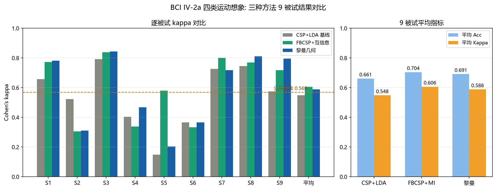

# 运动想象四类分类基线 (BCI Competition IV-2a)

基于 MOABB 的 `BNCI2014_001`（即 BCI Competition IV 2a）数据集，
用 **CSP + LDA** 复现四类运动想象（左手 / 右手 / 双脚 / 舌头）EEG 分类基线，
并进一步实现 **FBCSP + 互信息特征选择** 的优化方案。

## 环境

```bash
pip install -r requirements.txt
```

## 运行

```bash
# 基线方案（CSP + LDA）
python motor_imagery_baseline.py                # 默认 4 类
python motor_imagery_baseline.py --n_classes 2  # 左右二分类

# 优化方案（FBCSP + 互信息特征选择 + 黄金时间窗 0.5-2.5s）
python fbcsp_baseline.py                # 默认 4 类
python fbcsp_baseline.py --n_classes 2  # 左右二分类
```

首次运行会自动通过 MOABB 下载数据（默认到 `MNE_DATA` 指向的目录），无需手动准备 `.gdf` 文件。

## 流程

```
基线:  读取(MOABB) -> 带通 8-30Hz -> CSP -> LDA -> 分层 10 折 CV -> acc / kappa

优化:  读取(MOABB, 截取 0.5-2.5s) -> 4-40Hz 分 9 个子频带 -> 各频带 CSP
       -> 互信息筛选 Top 特征 -> Shrinkage LDA -> 分层 10 折 CV -> acc / kappa
```

## 输出

终端打印每位被试的准确率（accuracy）与 Cohen's kappa，以及 9 名被试的平均值。
（公开文献中 4 类 FBCSP 基线的 kappa 约为 0.569，可作为参考对照。）

## 实测结果（4 类，T 会话内分层 10 折 CV，random_state=42）



| Subject | CSP+LDA kappa | FBCSP+MI kappa | 黎曼几何 kappa |
|---------|--------------|----------------|----------------|
| 1 | 0.657 | 0.773 | **0.782** |
| 2 | **0.523** | 0.306 | 0.310 |
| 3 | 0.792 | 0.838 | **0.843** |
| 4 | 0.403 | 0.338 | **0.468** |
| 5 | 0.148 | **0.579** | 0.204 |
| 6 | 0.366 | 0.333 | **0.366** |
| 7 | 0.727 | **0.801** | 0.718 |
| 8 | 0.745 | 0.769 | **0.810** |
| 9 | 0.574 | 0.718 | **0.796** |
| **平均 kappa** | 0.548 | **0.606** | 0.588 |
| **平均 Acc** | 0.661 | **0.704** | 0.691 |

**主要结论**：

1. 两种优化方案均超过比赛公开基线（kappa ~0.569）：**FBCSP+MI 最优（0.606）**，黎曼几何次之（0.588），均明显优于 CSP+LDA 基线（0.548）。
2. **没有单一方法全面占优**：FBCSP+MI 在 S1/S5/S7/S9 占优，黎曼在 S4/S8/S9 占优。按被试取最优方法的"oracle 上限"约 0.663，提示**被试自适应方法选择/模型集成**是下一步最有价值的方向。
3. **个体差异主导**：S2/S4/S6 在三种方法下都低于 0.47，属于"困难被试"；S5 的判别信息可能分散在多个频带（FBCSP 0.579 远超其他方法的 ~0.2）。
4. ⚠️ 消融说明：FBCSP 相对基线的提升混合了**时间窗裁剪 + 滤波器组 + 互信息选择**三个因素，尚未单独拆分各自贡献。

## 目录结构

```
motor-imagery-bci/
├── motor_imagery_baseline.py    # 基线：CSP + LDA
├── fbcsp_baseline.py            # 优化：FBCSP + 互信息特征选择 + 时间窗裁剪
├── plot_method_comparison.py    # 生成 figures/method_comparison.png 对比图
├── figures/
│   └── method_comparison.png    # 三种方法 9 被试结果对比图
├── requirements.txt
├── README.md
├── .gitignore
└── LICENSE                      # 公开仓库建议添加
```

> 注意：原始 EEG 数据（`.gdf` / `mne_data/`）体积很大，**不纳入版本库**，
> 他人克隆后通过 `BNCI2014_001().download()` 自行获取数据。
